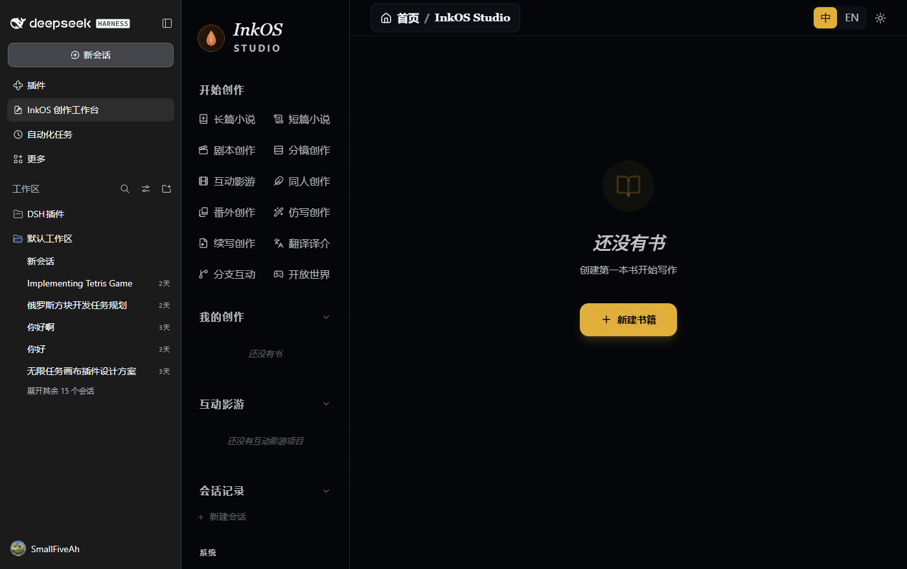

# dsh-inkos

把 [InkOS](https://github.com/Narcooo/inkos) 的创作工作台原样接进 **DeepSeek Harness**：
左侧栏「新会话」下方多一枚 **InkOS 创作工作台**，点它，中央舞台区里直接开出完整的 InkOS Studio ——
不跳浏览器、不开独立窗口。



```
DSH 左侧栏                        DSH 舞台区
┌──────────────────┐  点击   ┌──────────────────────────────┐
│  ⊕ 新会话         │  ───▶   │  InkOS Studio（原样嵌在舞台内） │
│  ▸ 插件          │         │  ├ 开始创作（长/短篇、剧本、分镜…）│
│  ▸ InkOS 创作工作台│ ◀选中   │  ├ 我的创作 / 互动影游 / 会话记录 │
│  ▸ 自动化任务      │         │  ├ 系统（题材/模型/项目/守护…）   │
│  ▸ 更多           │         │  └ 首页 / 新建书籍              │
└──────────────────┘         └──────────────────────────────┘
```

## 这不是「复刻」，是「原样跑起来」

InkOS Studio 是一整套 Vite + React + Hono 应用（建书、写作、多线推演、Short、Play、
翻译、封面、服务与模型配置……）。本插件**不重画任何一页**：

| 层 | 做法 |
| --- | --- |
| 页面与交互 | 直接跑官方 `@actalk/inkos-studio` 的前端产物，与 `inkos studio` 同一份 |
| 后端 | 直接跑官方 `dist/api/index.js` 子进程，API 全量 `/api/v1/*` |
| 项目 | 首次启动按官方 `project-bootstrap` 建工程（与 `inkos init` 同一份实现） |
| 插件自己 | 只做三件事：拉进程、报状态、把舞台那一格交给它 |

所以功能、页面结构、交互流程、显示呈现都随上游走：**不增、不删、不改**。
上游更新时，改 `package.json` 里的版本号即可，不存在「复刻追不上」的问题。

### 一处必须说明的干预：外链字体

Studio 的样式表第一行是一条外链字体导入：

```css
@import "https://fonts.googleapis.com/css2?family=Instrument+Serif…";
```

它是**渲染阻塞**资源，而且是最先被请求的那个。网络取不到 Google Fonts 时
（国内直连、受限代理都算），这条请求会一路挂到超时——实测 **30 秒**，
期间 Studio 整页白屏，接口和页面骨架都得排队等它。

所以插件在 Studio 前面放了一个本地网关（`lib/gateway.js`），同一个 origin、
路径 1:1 透传，只做两件最小的干预：

- `text/css`：摘掉指向外部主机的 `@import`（本地与相对地址保留）
- `text/html`：附一条只约束样式与字体的 CSP，防止将来又冒出新外链

其余请求（JS、图片、SSE `/api/v1/events`）原封不动地流过去。
代价是 `Instrument Serif` / `DM Sans` 回退到系统字体，界面其余部分不受影响。

**效果**：舞台从「转 30 秒」变成 **275ms 揭开遮罩、约 640ms 画出界面**。
不想要这个干预，把 `blockExternalAssets` 设成 `false` 即可恢复直连。

> 顺带一提：加载遮罩也不再只等 iframe 的 `load` 事件——它现在有 2.5 秒看门狗，
> 任何子资源再拖后腿，也不会把你挡在门外。

## 上游自动更新

**InkOS 一发新版，插件自己就跟上去。** 不需要你重新打包、重新装插件。

```
启动 20s 后查一次 → 之后每 6 小时查一次 → 也可 POST /dsh-inkos/update 手动触发
        ↓
npm 上是新版？
        ↓ 是
停掉 Studio 子进程（Windows 会锁文件）→ npm install 精确版本（两个包同步）
        ↓
真的把它起起来，探到 /api/v1/books 才算数
        ↓ 通过                          ↓ 不通过
换上新版本，revision +1              装回旧版、重新起、把这个版本记成「坏版本」
舞台 iframe 自动重挂，用户无感        以后不再重试该版本，等下一个小版本
```

几个刻意的设计：

| 决定 | 原因 |
|---|---|
| 只认「两个包同版本」的发行 | 上游 `inkos / inkos-core / inkos-studio` 精确互锁，混装会出现两份 core |
| 装完必须能真正启动 | 上游改结构时，宁可退回旧版，也不要留一个点了没反应的入口 |
| 网关端口固定 | 升级会换上游端口，但舞台 iframe 的地址不变——只重挂，不失效 |
| 失败记「坏版本」 | 避免每次轮询都重试一个装不上的版本 |
| 装前先停子进程 | Windows 上文件被占用，不先停会 EBUSY |

状态落在 `~/.dsh/inkos/updater.json`（上次检查、最近结果、坏版本、历史），
随时可以看一眼：

```bash
npm run update:status          # 只读：当前版 / 最新版 / 会不会升
npm run update:test            # 真机演练：降级到 1.7.2 → 让插件自己升回最新
```

`update:test` 会真的改 `node_modules`（跑完停在最新版），是这条链路最硬的验证。

### 关掉或收紧

```yaml
autoUpdate: false        # 完全手动
updatePolicy: minor      # 只跟小版本，大版本等你手动
updatePolicy: patch      # 只跟补丁
```

## 结构

```
dsh-inkos/
├── package.json          # DSH 清单：dsh.bundle.patch + dsh.client
├── cordis.patch.yml      # 把插件这一行插进 profile 的插件层栈（含默认配置）
├── lib/
│   ├── host.js           # 宿主半身：建项目 → 拉起 Studio → 起网关 → 状态路由 → 自动更新
│   ├── gateway.js        # 本地网关：1:1 透传，摘掉外链字体导入、补样式 CSP、端口固定
│   ├── updater.js        # 上游自动更新：版本比较、策略判定、装包、状态落盘
│   ├── bootstrap.mjs     # 子进程里跑官方 initializeProjectDirectory
│   └── client.js         # 网页半身：侧栏入口 + 舞台 iframe（版本变了自动重挂）
└── scripts/
    ├── selfcheck.mjs     # 清单 / 补丁 / 语法 / 版本判定 / CSS 改写回归
    ├── client-harness.mjs# 用极简 hooks 运行时真渲染两个组件
    ├── smoke.mjs         # 端到端：真起 Studio、真发 HTTP、真回收进程
    ├── update-e2e.mjs    # 真机演练自动更新：降级 → 自升 → 校验 → 回到最新
    └── update-status.mjs # 只读：当前版 / 最新版 / 会不会升
```

## 安装

前提：DSH ≥ `0.2.1-rc.2`，Node ≥ 22.16（InkOS 自身要求）。

**方式一：直接从 GitHub 装（推荐）**

```bash
dsh plugin --profile desktop add github:SmallFiveAh/dsh-inkos
```

`dsh` 就是 DSH 自带那个 CLI，桌面版在安装目录的 `resources/runtime/cli/bin/` 下
（Windows 是 `dsh.cmd`，macOS 是 `.../Contents/Resources/runtime/cli/bin/dsh`）。
它会连带把 InkOS 的依赖一起装上。

**方式二：从本地克隆装（改代码时用这个）**

```bash
git clone https://github.com/SmallFiveAh/dsh-inkos.git
cd dsh-inkos
npm install                                   # 装 @actalk/inkos + @actalk/inkos-studio
dsh plugin --profile desktop add link:.       # Windows 可用 link:E:/path/to/dsh-inkos
```

> Windows 上 `link:` 建议用正斜杠；在 git-bash 里调 `.cmd` 要加 `MSYS_NO_PATHCONV=1`，
> 否则 `E:/` 会被改写成 `/e/`。

装完 **重启 DSH**，侧栏「新会话」下方就会出现入口。

卸载：

```bash
dsh plugin --profile desktop remove dsh-inkos
```

## 使用

1. 启动 DSH，左侧栏「新会话」下方多出 **InkOS 创作工作台**（宿主启动时插件已自动预热 Studio）。
2. 点它，中央舞台区切到 InkOS Studio，页面铺满舞台；点「新会话」或别的面板即可离开，Studio 进程继续在后台待命。
3. 首次使用请在 Studio 的「系统 → 模型配置」里填 LLM 服务（与单独跑 `inkos studio` 完全一致）——没有 key 时界面照常可用，只是不产出内容。

> 入口是 DSH 的**面板**（`sidebar.panellist` + `main`），所以点击走的是宿主原生的
> `layout.selectPanel(id)`，舞台自然切换，不需要任何 DOM 注入。

## 配置

改 `cordis.patch.yml`（或你自己的 patch 层），重启生效：

| 字段 | 默认 | 说明 |
| --- | --- | --- |
| `projectRoot` | `~/.dsh/inkos/project` | InkOS 工程目录（含 `inkos.json`）。想接已有小说工程，填绝对路径 |
| `port` | `0` | Studio 端口；`0` = 每次启动自动挑空闲端口 |
| `language` | `zh` | 自动建项目时的默认语言（`zh` / `en`） |
| `readyTimeoutMs` | `90000` | 等待 Studio 就绪的上限 |
| `blockExternalAssets` | `true` | 网关摘掉外链字体（关掉＝退回 30 秒白屏的直连行为） |
| `autoUpdate` | `true` | 跟随 InkOS 上游发行版自动升级 |
| `updatePolicy` | `latest` | 允许跨度：`patch` / `minor` / `latest` / `off` |
| `updateCheckHours` | `6` | 检查间隔（小时） |
| `updateStateFile` | `~/.dsh/inkos/updater.json` | 更新状态落盘位置 |

## 自检

```bash
npm run check    # 静态清单 + 网页半身行为（无需启动 DSH）
npm run smoke    # 真起一个 Studio：建项目 → 起服务 → 校验首页/产物/API → 卸载回收
```

`smoke` 会打印每一步的实测结果，末尾确认「卸载后端口不再监听」，用来防子进程泄漏。

## 故障排查

| 现象 | 处理 |
| --- | --- |
| 侧栏没有入口 | 插件没被加载。确认 `plugin list` 里有 `dsh-inkos`、`cordis.patch.yml` 里 `name` 与包名一致，然后重启 |
| 舞台显示「InkOS Studio 没起来」 | 卡片上会带原因与尾部日志；点「重新启动 Studio」重试。常见原因是依赖没装（`npm install`）或端口被占 |
| 页面一直在「正在打开…」 | 已修：遮罩最多 2.5 秒即揭开。若揭开后仍是空白，看下面两条 |
| 揭开后一片空白 / 没有样式 | 多半是网关改坏了样式表。跑 `npm run check`（含 CSS 改写回归）；急用可先把 `blockExternalAssets` 设 `false` |
| 想找回原来的项目 | 工程目录在 `~/.dsh/inkos/project`，删掉即重新初始化 |

## 许可

插件本体：AGPL-3.0-only（与所集成的 InkOS 保持一致）。
InkOS 版权归 [Narcooo/inkos](https://github.com/Narcooo/inkos) 作者所有。
